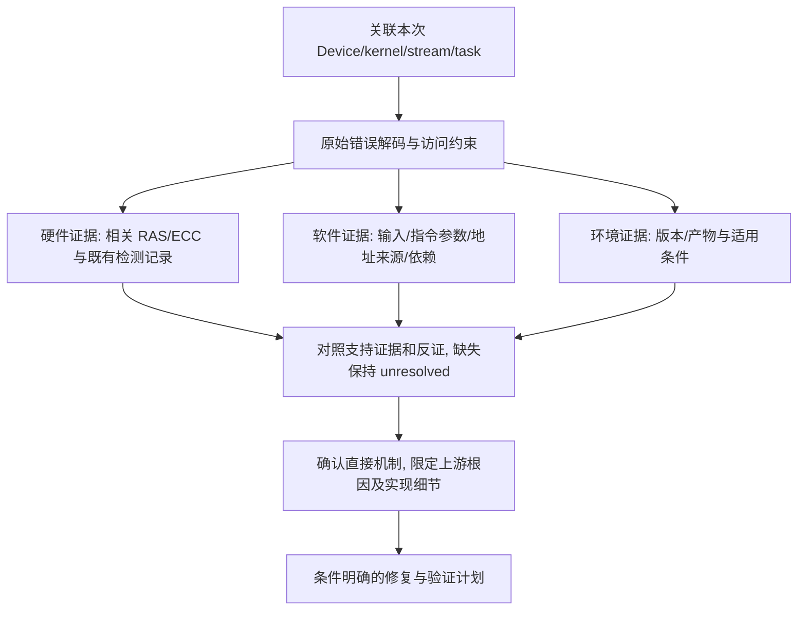

# AI Core Error 典型故障处理流

> **执行入口**：入口场景 `aicore_error`。核对 [AI Core Error 专项](../ai-core-reference.md) 的适用边界；需要清洗或流水线产物时查 [公共约定](common-flow.md)。只分析已提供的 plog、event、exception dump、算子产物、工具结果及验证记录，不执行硬件压测、换卡复跑或重新抓 dump。现场操作（`ascend-dmi` 压测、`msaicerr`、换 Device 复现等）不执行，只在已有材料中找对应结果/字段；没有这些结果时记 `evidence_gaps`，继续现有日志证据分析。

## 问题现象

常见入口包括：

```text
EZ9999: Inner Error!
there is an aivec error exception
there is an aicore error exception
Aicore kernel execute failed, device_id=0, stream_id=10, task_id=42
fault kernel_name=MatMulV2.op123
```

`EZ9999` 是上层通用错误码，不能单独作为根因。必须继续提取嵌套错误中的 `serial number`、`chipId`、`core id`、`error code`、`errorStr`、`fault kernel_name`、`device_id`、`stream_id` 和 `task_id`。

自定义 kernel 涉及 Fixpipe、GlobalTensor、GM/UB 搬运或 TQue 时，按
[公开 API 约束](../ascend-kernel-api-contracts.md)核对具体修改对象、参数单位和
条件修复；没有源码或参数转储时仍区分公开契约、候选原因与已确认现场。
CUBE/MMAD 操作数、L1 到 Fixpipe Buffer、LOAD3DV2 或 DataCopyPad 线索则选读
[Cube/MTE 约束](../ascend-cube-mte-contracts.md)，检查实际派生指针、布局、单位
及完整访问跨度；不能由单码补造具体 API、参数值或芯片容量。

## 排查流程

AIC Error 定位流程主干：**关联本次任务 → 解释错误解码及可计算的访问约束 → 并行核对硬件、输入、实现、依赖与环境证据 → 比较候选根因 → 给出针对性修复和未解决边界**。日志未提供的检查结果保持未知；某分支无支持不影响已有直接机制的确认。

设备错误解码后增加一个强制的“实现线索检索”步骤：在当前 `log/` 全范围检索 `DataCopyPad`、`Fixpipe`、`LoadData2D/3D`、`asc_copy`、`workspace`、`tiling`、`PI`、`capture`、`IMP/DISP`、`ACSVIOL`、`ECC`，对每个命中读取前后完整上下文，并用 kernel/hash/PC 与任务绑定。若命中具体 API 参数、源码片段、参数转储或题面已报告的实现结论，必须将其纳入 `implementation_root_cause` 和修复绑定表；没有命中才保留为 hypothesis/undetermined。该步骤不能由单个错误码、kernel 名或后置 `Task run failed` 代替。

### 构建标签到源码分支

`build_error.log` 中的构建目录是当前产物的现场线索。读取标签后，使用当前材料中可获得的
任务标识（例如 `errorStr`、kernel/hash、PC、参数快照、时间和设备）交叉核对它是否属于
同一执行产物；某个标识缺失时记录证据缺口并降低标签置信度，但不阻断设备错误的直接机制
诊断。随后把标签绑定到**可检查的源码对象**。标签可以收窄排查分支和修复对象，但不能
凭目录名补出源码常量、指令操作数或执行结果。下面的映射只在设备错误与标签一致时成立：

| 标签示例 | 与错误串一致时的优先检查 | 仍不能直接断言 |
| --- | --- | --- |
| `atomic_dirty_cacheline` | scalar 访问内部 buffer 越界：先按设备 `errorStr` 检查 UB/内部 buffer 声明、标量 store 偏移和完整访问范围；只有日志另有 atomic 指令/目标证据时，才把 cacheline 冲突列为上游候选 | 标签不证明 atomic 路径实际执行，也不能补出 `OOB_OFFSET`、buffer 大小或 OOB 兜底分支顺序 |
| `dcache_biu_response` | scalar 访问 GM 超过 48 位：检查 kernel 内部指针算术、整数转换和 scalar 直接解引用的派生地址；入口 args 合法时优先追派生地址 | `1ULL << 48`、实际 badGm、Dcache/BIU 指令序列，除非有源码或反汇编 |
| `fixp_b4_misalign` | FIXP 读取 L0C 越界：先确认芯片、CANN 版本和实际 API 变体；若确为 `FixpipeParamsV220`，核对其源布局、完整读取跨度及 `mSize/nSize/srcStride/ndNum/srcNdStride/unitFlag`，否则按对应变体契约核对等价字段，再按现场地址判断 B4 对齐分支 | 目录中的 `misalign` 不证明对齐是实际触发项，也不能把 V220 的单位/范围套到未确认的变体，更不能补出具体 stride 或 unitFlag |
| `fixpipe_addr_misalign` | FIXP 读取 L0C 越界：先确认 API 变体后，按该变体的源地址、stride、切片偏移和完整读取范围比较候选；只有现场地址不满足约束时才把对齐列为首要上游原因 | 某个固定偏移或 `srcStride` 数值，不能把标签单独升级为源码级根因 |

输出时仅在标签与设备错误一致时把标签写入 `upstream_trigger` 的证据引用；标签冲突时
写入 `classification_conflicts` 或 `evidence_gaps`，不能作为支持证据。设备错误串写入
`direct_mechanism`。如果标签只支持“该变体针对某类缺陷构建”，就给出该类缺陷对应的
条件修复和验证判据，同时明确缺少的字段；不要将标签改写成已确认的 `file:line` 或
现场实参。这样既能利用构建产物收窄故障对象，也能避免把一个标签误当成精确源码证明。



| 顺序 | 证据 | 判断条件 | 下一步 | 中间过程记录 |
| --- | --- | --- | --- | --- |
| 1 | Device event 日志 | 与本次关联的 `event_id` 已按型号和版本解码 | 评估对应 RAS 故障；未知定义不猜测 | 记录 event_id、定义、时间和设备关联；缺日志则分支未解决 |
| 2 | 故障时间附近的 plog | ECC 或同一 `chipId` 多次报错 | 查阅已有硬件检测与控制变量对照 | 记录 chipId、独立事件数、ECC 类型；重复位置不单独证明坏卡 |
| 2a | `ascend-dmi` 压测结果 | 匹配本次设备和环境的既有异常 | 支持硬件候选，结合告警与业务故障关联 | 记录异常详情；PASS 只说明该次检测未发现异常，不排除间歇问题 |
| 2b | 换 Device 复现记录 | 原 Device 异常、其它 Device 不复现 | 在控制输入/产物/配置后提高硬件候选优先级 | 记录各设备结果、重复次数和控制变量；一次不复现不确诊硬件 |
| 2c | 产品型号、`error code`、网络诊断记录 | A3 超节点且 `0x800000`：核对灵衢网络是否有端口闪断/超时代答/信用证反压/非法报文 | 有网络故障→转网络排查流；无→继续索引检查 | 记录产品型号、是否 A3 超节点、网络诊断结论、是否有端口闪断/超时代答等告警 |
| 3 | 算子类型、`error code`、输入 | 索引类算子出现 `0x800000` | 检查输入索引范围 | 记录算子名、error code、errorStr、index 值与输入维度对比 |
| 4 | exception dump、`.o/.json` | 不是已确认的索引输入问题 | 使用 `msaicerr` 解析并保留 `info.txt` | 记录 dump 路径、算子 hash、msaicerr 根因结论、解析是否成功 |
| 5 | 历史记录 | 是否每次在同一 Device 发生 | 比较设备与输入/产物/作业分配的相关性 | 记录历次 Device ID、负载和复现条件；不依据位置独立作软硬件判定 |
| 6 | 软件修复验证 / 硬件换板记录 / 资源池观察 | 原失败条件下首错消失且结果/回归符合预期 | 验证通过才记已解决；失败保留未解决，观察中保留 hypothesis | 记录修复措施、控制条件、实际结果与回归范围 |

采用流水线产物模式时，每步过程写入 `diagnosis.md.result.steps`；默认诊断答复在正文说明关键核对过程及证据，不要求生成该文件。

按现有证据并行核对 RAS/ECC、明确的索引类输入问题和匹配的 `msaicerr` 结果，不要求补齐某一分支后才能分析其他分支。案例候选必须核对算子、版本、设备、首错和输入条件；相同 kernel 或十六进制寄存器值不等于相同根因。core 与 AI Core Error 同时存在时，按任务关联和时间线区分 Device 异常、Host 传播及独立崩溃，不按固定优先级覆盖较早事件。

## 证据盘点

| 材料 | 提取字段 | 缺失/不匹配的影响 |
| --- | --- | --- |
| 原始 plog / 屏幕日志 | serial number、时间、chip/die/core、kernel、device/stream/task、error code/errorStr、PC/参数地址 | 无法确认的关联或首错序号标 unknown，不把最后一条框架异常当首错 |
| 对应 Device 的 event / 黑匣子存档 | event_id、发生时间、设备、RAS/ECC 原文与处置状态 | 未提供 event 不代表没有硬件异常 |
| 已有 exception dump、`.o/.json` | kernel/hash、编译版本、输入输出地址/shape/dtype、tiling、参数映射 | 对应关系不明时不能将解析的 file:line 当作本次故障位置 |
| 已有 msaicerr `info.txt` | 根因提示、故障指令、地址映射、解析失败、材料对应关系 | 工具报解析/取 dump 失败属于工具结果，不自动证明算子错误 |
| 已存档硬件与复现记录 | ECC/健康、`ascend-dmi` 诊断结论、使用设备、控制变量、原始结果 | 只把既有记录作为证据，不启动新检测 |

保留完整寄存器多行块、任务下发/完成、Event Record/Wait、正常参数与前后任务日志。清洗不能只留下 `EZ9999` 一行或删除低级别的任务关联信息。

### 子检查

| 子检查 | 离线核对内容 |
| --- | --- |
| Ascend DMI 工具压测核对 | 核对已有 `ascend-dmi` 结果的版本、设备、检测项及覆盖范围。`PASS` 只表示本次检测未发现异常；`GENERAL_WARN` 或 `EMERGENCY_WARN` 须解释具体异常及其与业务事件的关联。工具参数和资源需求按该版本帮助核对。未提供结果时记 `evidence_gaps`，不执行新压测 |
| 硬件故障定位子流程 | 硬件故障定位流程：① 收集 Device 日志、BMC 日志后核对是否有 RAS 告警；② RAS 告警与 AICERROR 是否关联（时间、设备、芯片）；③ 无 RAS 告警时核对是否有其他已知问题；④ 隔离问题节点后核对单算子微流程用例是否必现；⑤ 用典型高压用例（FA、MatMul 等）压测是否复现；⑥ 重启后用复现场景再次复现；⑦ AC 下电再上电后再次复现；⑧ 收集实验数据（是否固定 core、错误码、报错算子、bus CPM、aic CPM、复现时间、相关寄存器信息）交芯片团队给结论。每步仅核对已有记录，不执行现场复现 |
| 软件故障定位子流程 | 核对异常算子 `.o/.json`、原始 plog、dump 与已有 `msaicerr` 或检测结果的对应关系。`0x800000`+`mte_biu_rdwr_resp` 时检查实际访问地址、映射、生产者和生命周期；有相关 ECC 或适用 A3 网络证据时再提高对应候选优先级。`0x0`、timeout 或 trap 也须结合任务进展及指令解释，不能直接套用历史根因。工具结果缺失不妨碍分析已有证据；仅核对已有结果，不执行新工具 |
| A3 超节点灵衢网络排查 | A3 超节点出现 `0x800000` 时核对灵衢网络诊断记录：有网络诊断平台时优先核对诊断结果；无诊断平台时核对网络设备告警信息——端口闪断/Down、超时代答、信用证反压、非法报文。核对结果区分灵衢侧异常（给解决方案）与昇腾侧异常（昇腾研发分析）。记录网络诊断结论、告警类型、是否与本次 AICERROR 时间关联 |

## 分支与竞争假设

| 分支 | 评估动作 | 结论边界 |
| --- | --- | --- |
| RAS / ECC | 对齐 event_id、时间、设备及当前版本故障定义，解释对应异常 | event_id 需正确解码且与本次相关；不能把任意 event 当硬件定论 |
| 同 chip/core 反复异常 | 结合已有 ECC、硬件测试和换设备对照记录 | 重复位置是候选证据，不能单独判芯片损坏，也不自设重复次数阈值 |
| 索引/地址异常 | 核对索引类算子、errorStr、实际 index 范围、输入维度与地址来源 | `0x800000` 不单独证明索引越界；缺输入证据时保留候选 |
| 内存生命周期/搬运 | 对照已有 dump、tiling、地址范围、生产者及分配/释放序列 | 报错 kernel 可能只是受害者，须核对更早的写入或错误参数来源 |
| 任务超时/Event 等待 | 对齐 dispatch/done、Event Record/Wait、流和任务依赖 | 缺 done 不自动证明死循环；没有完整日志不能排除正常完成后未记录 |
| 版本/产物不匹配 | 核对 CANN、硬件、编译 hash、工具和符号版本 | 不匹配会限制解析可信度，不等于它已经造成业务故障 |

有相关证据时先解释 RAS/ECC，再评估明确输入问题与软件分支；该顺序不是要求补齐前一分支材料后才能继续。缺某来源则记录该分支未解决，继续已有软件证据分析。

### 分支决策顺序

以下为证据检查索引，按本次错误涉及的分支展开，不因缺失材料提前结束。默认诊断答复只需解释有信息量的核对结果；不要求将全部分支排成排除表：

1. **事件关联**：确认错误与 host/PID/rank/device/stream/task 及时间窗属于同一任务；关联失败时只保留为候选。
2. **RAS/ECC**：查找同一 Device 的 `event_id`、ECC 类型和处置状态；有明确且匹配的定义时标记硬件分支支持。
3. **索引/地址**：核对算子类型、`errorStr`、输入索引或地址范围；`0x800000` 单独出现时保持 unresolved。
4. **任务与内存**：核对 dispatch/done、参数地址、生产者任务和生命周期，识别受害 kernel 与更早写入者。
5. **工具解析**：仅对版本、Device、stream/task、hash 均匹配的已有 dump 使用 `msaicerr`；解析失败记录为工具结果和证据缺口。
6. **版本/产物**：核对运行时与编译产物版本/hash；不匹配只降低该证据的可用范围，不直接生成根因。

流水线模式把各分支写入 `branch_decisions`，至少包含 `branch`、`status`（`supported`/`excluded`/`unresolved`）、`evidence_refs`、`counter_evidence` 和 `reason`，确保缺证与排除理由可追溯。默认答复可在相关结论旁直接说明支持、反证和限制。

`excluded` 需要与具体假设不相容的证据。未出现相关关键词、某错误位为零、非空且对齐的 args、正常资源回收、PC 距入口较近，均不能单独排除非法地址、上游写坏、生命周期或硬件分支；也不能把未观测到的分支写入“已证实排除”。没有支持时记录 `unresolved` 并说明当前优先级。最终正文与分支表采用同一结论，不能在摘要中把“无支持”改成“已排除”。

## 子步骤产物

流水线模式的步骤写入 `diagnosis.md.result.steps`，每项带公共状态、输入/证据引用、缺口及 next_step。

| step_id | 执行动作 | findings 必含字段 |
| --- | --- | --- |
| A1 | 案例与本次 AI Core 入口核对 | entry_errors、signals、nested_error_details、case_comparison、event_identity、classification_conflicts |
| A2 | 盘点版本、任务与已有异常产物 | material_inventory、versions、kernel_hash_mapping、task_identity、parse_results、mismatches |
| A3 | 首错与依赖链分析，按流程评估各分支 | first_error_candidate、serial_scope、timeline_links、ras_ecc_assessment、network_assessment、input_address_assessment、task_dependencies、branch_decisions、alternative_decisions |
| A4 | 输出结论、建议和检查依据 | confirmed_facts、root_cause_status、limitations、recommendations、check_evidence |

A4 同步填充公共诊断字段。`serial number` 只能在可比较的同一记录范围内辅助定位首错，不跨主机/进程机械取全局最小值。

## 结论与可信度

- 直接事实："<device/stream/task> 的 <kernel> 报 <原文异常>"；根因需继续用指令、参数/地址来源、RAS 或源码证据支持。
- 无 dump 仍可评估现有日志/RAS/参数证据；不追加能力等级或总分上限。无法解析的位置和无法排除的竞争假设必须保留。
- D1/D2 首错与互证须对应同次任务；D3 仅 kernel 名不满足根因已定位；D4 无已有修复记录不记已验证；D5 案例命中需核对版本及实际证据异同。
- `msaicerr` 报错本身不为 `source_code_confirmed` 加分。只在已有匹配源码与现场证据证实推断时填 true。

案例参考先核对已有检索候选（流水线使用 `case-match.md`），再核对 [专项案例](../ai-core-reference.md)；未命中仍完成全部诊断。建议只写适用前提与已有验证状态，不执行修复生产环境。

## 案例覆盖矩阵

下表把专项中的案例映射到本流分支，确保命中任一案例时均有明确核对路径；案例命中仍需现场证据闭合：

| 案例 | 入口特征 | 对应分支 | 必要核对 |
| --- | --- | --- | --- |
| OFFICIAL-0009 | `0x80E01809`/`0x80E01801`、multi-bit ECC | RAS/ECC | event 定义、Device、地址与处置状态 |
| OFFICIAL-0010 | `0x80C98000`、`compare_fail_num != 0` | RAS/ECC | trace 与 event 时间、适用产品 |
| OFFICIAL-0011 | data-cache 2-bit ECC | RAS/ECC | 型号/版本解码、任务关联与恢复状态；DMI 为补充证据，缺失不抹去已检测 ECC |
| OFFICIAL-0012 | 索引类算子 + `0x800000` | 索引/地址 | index、shape、dim 和地址生产者 |
| OFFICIAL-0013 | built-in sample operator 失败 | 工具解析/环境 | 详细失败阶段、环境/编译结果及是否实际出现样例 Device 异常 |
| OFFICIAL-0014 | single-operator test 失败 | 工具解析/环境 | 区分未执行成功与实际复现 AI Core Error，核对输入、产物及测试日志 |
| OFFICIAL-0015 | atomic add precision overflow | 任务与内存 | 算子类型、输入范围与已有验证 |
| OFFICIAL-0016 | input/output address abnormal | 索引/地址 | 地址范围、分配记录和上下游任务 |
| OFFICIAL-0017 | args before/after execute 不一致 | 任务与内存 | 参数快照、stream/task 和时间顺序 |
| OFFICIAL-0018 | failed to get dump data | 工具解析 | 取数阶段/返回码、上下文与对象生命周期；失败本身不证明原访问地址非法 |
| OFFICIAL-0019 | args after execute 含错误地址 | 任务与内存 | Host/Device 地址、参数来源和版本/hash |

未命中上述案例时继续从本次错误字段、输入和执行过程分析，不套用最近似案例的上游根因。流水线模式仍完成 `A1`–`A4` 并在 `case_comparison` 中说明案例差异。

参考：[公共约定](common-flow.md)、[AI Core Error 专项](../ai-core-reference.md)、[故障处理专题](../fault-handling.md)、[网络排查流](network-flow.md)、[错误码](../err-messages.md)、[可信度规范](../confidence-assessment.md)。
