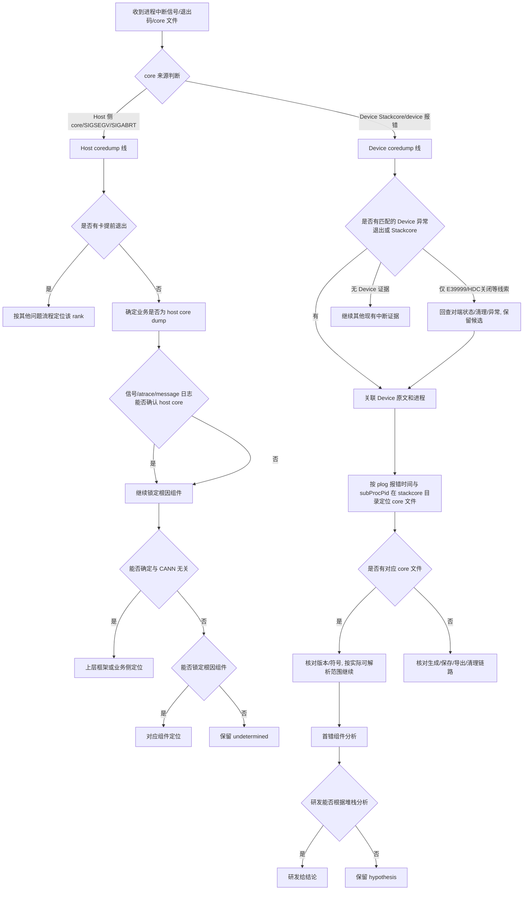

# 进程中断典型故障处理流

> **执行入口**：入口场景 `crash`。已有 Host core、Device Stackcore、异常信号或明确进程中断记录时使用本流。只离线分析现有材料，不附加运行进程，不重新触发崩溃或抓取 core。现场解析（`gdb`/`asys analyze`）转为对已有 core/Stackcore 的离线解析。需要清洗或流水线产物时查 [公共约定](common-flow.md)。

## 问题现象

常见入口包括：

```text
Segmentation fault (core dumped)
Aborted (core dumped)
Fatal Python error: Segmentation fault
RuntimeError: CANN error, error code: ...
# 有时无明显报错，进程直接消失
```

退出码参考：139 = SIGSEGV（段错误），134 = SIGABRT（异常终止），137 = SIGKILL（被杀，可能是 OOM Killer，但不等于 OOM）。

## 排查流程

coredump 按实际来源区分 **Host Linux core**、Host tracer Stackcore 与 **Device Stackcore**。按已有信号、进程及产物选择对应解析方法；plog 未报错只限制该来源的覆盖，不能据此确定责任在上层。



| 顺序 | 证据 | 判断条件 | 下一步 | 中间过程记录 |
| --- | --- | --- | --- | --- |
| 1 | 信号、退出码、core 文件来源 | Host core / Device Stackcore | 进入对应线 | 记录信号类型、退出码、core 文件路径、来源是 Host 还是 Device |
| 2a | 各 rank 退出/进展、plog 覆盖、训练日志 | 按 PID/rank 关联真实退出记录及对应依赖；小文件、无超时或 `GEfinalize` 只作线索 | 有证据的退出原因按 OOM/掉卡/通信分支追踪，其他项保留未知 | 记录局部时间线、跨机时钟依据、清理与退出的区别及日志缺口 |
| 2b | core 文件、信号、堆栈、atrace、host message 日志 | 用可用来源确认 Host 中断及实体关联，不要求固定三份材料 | 继续匹配符号和触发点 | 记录已提供的信号/产物及其范围，缺失来源不补造 |
| 3 | atrace 日志 | 关键帧、接口及资源对应本次进程 | 定位直接执行点并继续追参数/生命周期 | 记录关键帧及符号可靠性，不将帧归属直接变成根因责任 |
| 4 | 堆栈与对象来源 | 上层/CANN 帧及上游参数或写入关系 | 比较责任候选；缺帧不排除较早的破坏者 | 记录栈覆盖、参数流及反证 |
| 5 | CANN 组件及更早事件 | 触发点是否与具体原因闭合 | 闭合→对应原因；未闭合→候选或undetermined | 记录直接组件、上游候选及证据边界 |
| 6 | Device 原文、退出/信号记录、匹配 Stackcore | `E39999`、HDC 关闭和 `Server destroy success` 仅为候选线索，确认中断/core 须有对应证据 | 继续关联进程和材料；正常清理、外部终止及设备异常均按证据比较 | 记录原码、现场版本、PID/任务、关闭/退出状态与时间依据 |
| 6a | plog 时间、Device组件及 subProcPid | 在 `stackcore/dev-os-*/` 按设备、PID和故障窗匹配core，防止PID复用 | 找到→核对符号；未找到→生成/保存/导出/清理链路 | 记录设备、时间、组件、PID和文件的对应关系 |
| 7 | 已有 Stackcore、版本对应 so 和符号 | 分开判断core是否存在及符号是否匹配 | core存在且符号匹配→离线解析；缺/错符号→按地址/模块继续并记符号缺口；无core→核对保存链路 | 记录core实际状态、so/build-id来源和匹配范围；不把缺符号当成未生成core |
| 8 | stackview.sh 解析后堆栈 | 首错组件 | 研发分析 | 记录首错组件、符号匹配状态、故障线程、故障地址、so 文件映射路径（如 `libaicpu_scheduler.so`/`libpt_kernels.so`） |
| 9 | 研发分析记录 | 能否给结论 | 有→结论；无→hypothesis | 记录研发结论或"无研发记录" |

采用流水线产物模式时，每步过程写入 `diagnosis.md.result.steps`；默认诊断答复在正文说明关键核对过程及证据，不要求生成该文件。

### 判断属于哪条线

| 判断依据 | host coredump | device coredump |
| --- | --- | --- |
| core/中断来源 | Host Linux core、Host tracer Stackcore 或 Host 信号记录，按真实来源解析 | 已关联 Device 的 Stackcore、异常退出/信号记录 |
| 关键报错码/日志 | 训练日志信号、atrace 堆栈和 Host message 等可互证的来源 | `E39999`、HDC关闭或 server 销毁需回查具体事件；仅这些记录不确认 Device core |
| 可用关联材料 | 已提供的 plog、atrace、message、core及退出记录 | 已提供的 plog、device、Stackcore及退出记录 |
| 报错位置 | Host 进程堆栈 | Coredump 的 device 报错 |

两条线可能同时存在；按任务关联和时间线区分本次主中断与传播，不按固定优先级覆盖较早事件。退出码 137 仅为 SIGKILL 线索，不能确认段错误或 OOM；退出状态含义结合 shell/容器/调度器原始记录核对。明确 Python 异常退出与 native signal core 分开记录；框架最后一条异常可能是此前 Device/OOM 故障的传播。

### 无 core 或符号不可用时

没有 Host core、Device Stackcore 或可读符号时，仍按本流完成诊断：

1. 从退出记录、信号文本和应用日志确定可确认的中断事实，并在 `first_error` 中引用原始位置；
2. 以崩溃前后的日志、线程/任务标识和时间窗建立可见时间线，无法定位的事件保留为 `unknown`；
3. 将"直接触发位置"与"上游根因"分别标记。只有信号而无访问地址或调用链时，`root_cause.status` 使用 `hypothesis` 或 `undetermined`；
4. 说明缺失的 core、符号或版本信息及其影响，照常交付诊断；流水线将缺口与结论写入 `diagnosis.md`，不以缺少文件为由跳过诊断。

Python 异常栈只反映解释器层面的退出路径；除非有 native 信号、core 或设备错误与其形成时序和实体关联，否则不将 Python 最后一条异常升级为 native 崩溃根因。

题面给出“传入空参数后SIGSEGV”时，可优先检查接口与调用者的空参处理，并给出条件修复。没有调用栈、故障指令和参数流时，库内解引用、调用者误用返回值以及具体发生在GetWorkspaceSize或执行段均需继续区分；初始化成功、缺少校验ERROR日志或未见device执行记录不能证明具体崩溃帧。首段定位沿用这一范围，不能先指定函数和责任方，再只在末尾声明未知。寄存器与gdb命令按core架构选择，不将x86的`rip`套用到AArch64现场。

## 证据盘点

| 材料 | 提取字段 | 核对要求 |
| --- | --- | --- |
| Host core | 文件类型、架构、进程/线程、信号、PC、寄存器、映射及崩溃时间 | 与 exe、PID/任务和故障时窗对应；只有文件存在不足以记"产物齐备" |
| Device Stackcore / 已有 asys 输出 | Device、进程/线程、信号/异常、寄存器、栈帧 | 与 Host Linux core 分开解析，不能套用错误格式 |
| exe、debug so、已提供依赖 | Build ID、版本、架构、加载映射、符号状态 | 匹配才使用符号定位；不能拿其他版本的漂亮栈帧代替未解析地址 |
| 应用/plog/device/内核存档 | 崩溃前首错、正常执行与资源生命周期、rank/PID/task 关联 | 原文和多行堆栈完整保留，不能仅截取最后 ERROR |
| 已有源码与验证记录 | commit/ref、对应函数、触发输入、修复/回归结果 | 明确哪些是现场事实、代码支持的推断及已验证结果 |

根据 [命令手册](../coredump-command-playbook.md) 使用安装且适用的离线工具解析已有文件；记录工具版本、参数、输入哈希、输出及错误。工具不可用或符号不匹配时保留地址/模块和限制，继续现有日志分析。

### 子检查

| 子检查 | 离线核对内容 |
| --- | --- |
| core 文件生成与保存条件 | 先区分 Host Linux core、Host tracer Stackcore 和 Device Stackcore。Host 核对故障进程实际 RLIMIT、dumpable、`core_pattern` 的直接文件/管道处理器模式，以及目录权限、存储、处理器和清理/导出记录；有限上限可允许生成，管道模式按内核/处理器语义核对。普通进程不要求 `suid_dumpable=1`，该项针对受保护进程。Device 按对应版本配置核对。只有具体阻断/失败记录支持时才确认 core 缺失原因，否则记缺口；不修改现场配置 |
| 如何确定是否有卡提前退出 | 按同一 PID/rank 的实际退出、信号、调度及进展记录核对生产者是否失去推进能力。小 plog、无超时报错和 `GEfinalize`/析构仅作覆盖或清理线索，不证明进程退出；关联时保留跨主机时钟误差和日志缺口 |
| 判断是否为 Host Core Dump | 用实际信号、Host core、atrace、应用或 message 等可用来源交叉核对；信号事实、转储已生成与文件已收集分别记录，不设固定材料数量前置条件 |
| 如何确定为 Device core dump | 核对匹配的 Device 进程异常退出/信号、Stackcore 和具体日志；`E39999` 或 HDC session closed/server 销毁不独自证明崩溃、先后或 core 已生成。正常清理、外部终止及上游故障的传播仍需区分，数字返回码按现场版本核对 |
| 如何找到对应业务的 core 文件 | device 日志 slog 同级目录下有 `stackcore` 文件夹，进入后找到 core dump 的 device id，`stackcore/dev-os-*/` 下有 `stackcore.aicpu_scheduler.*` 的 core 文件（可能有多个）。按 plog 报错时间点，在 `slog/dev-os-*/debug/device-os/` 中根据 `subProcPid` 找到对应组件报错，再回到 `stackcore/dev-os-*/` 下匹配文件名包含该 subProcPid 的 core 文件 |
| 如何解析 core 文件确定问题组件 | 解析 core 文件需匹配版本对应的 so 文件：按现网报错版本找到对应 opp 包解压；core 在 aicpu 组件找 `Ascend910-aicpu_syskernels.tar.gz`，core 在其他组件找 `Ascend910-aicpu_extend_syskernels.tar.gz`，部分 so 文件在驱动包的 `filesystem-le.cpio.gz` 中。将对应 so 文件与 core 文件放同级目录后，用 `stackview.sh -c <core文件> -p ./` 解析。解析后根据堆栈中 so 文件归属（如 `libaicpu_scheduler.so`/`libpt_kernels.so`）定位首错组件，交组件研发进一步分析 |
| 首错组件分析 | 从解析堆栈/日志中定位首报错组件（GE/ACL/HCCL/Runtime/驱动等），区分首错与传播 |

## 判定矩阵

| 候选原因 | 支持证据 | 不足以定论的信号 |
| --- | --- | --- |
| 空指针/非法地址访问 | 匹配符号的故障指令、寄存器、对象/参数及代码路径 | 仅 SIGSEGV 或地址接近零 |
| 越界/use-after-free | 已有检测报告、分配/释放或写入路径、对象生命周期与故障访问关联 | 任意崩溃栈、坏地址或 allocator 报错 |
| 断言/主动 abort | SIGABRT 与断言原文、触发条件、调用链一致 | 仅 libc abort 栈顶，未追上游触发原因 |
| 版本/ABI 不匹配 | 实际加载的库、ABI/符号/布局冲突与现场调用链 | 只发现工具或符号包版本不一致 |
| 并发/生命周期错误 | 线程关系、锁/资源销毁和使用的顺序证据或既有验证记录 | 单次堆栈显示在锁、析构或 free 中 |
| Device/OOM 异常传播 | 较早的已关联 Device/内存异常到 Host 中断的链路 | 同包里有 EZ9999/EL0004，但时间或进程无法关联 |
| 外部终止 | 匹配调度/容器/系统退出原因记录 | 仅"进程消失"或退出码 |

先解释直接触发点，再追上游原因。崩溃线程可能只是受害者；没有既有分配/写入证据时，不凭终点栈推定上游内存破坏者。

ACLNN 二阶段执行附近的重复释放或对象失效，按
[executor 所有权规则](../crash-reference.md#aclnn-executor-所有权与重复释放)
区分普通自动释放与已启用复用后的显式销毁，结合实际对象/调用记录提出对应修复。

`strcmp`、`memcpy` 等栈顶也可能访问非空的悬空、越界或损坏地址，不能只凭函数名
确认空指针或库内责任。ABI 参数寄存器约定适用于调用入口；例如 AArch64 的
`x0-x7` 在函数内部可存中间值，故障点需结合反汇编和数据流恢复实际操作数。
x86 的 `MOVAPS`/`#GP` 与空信号地址需按[架构语义](../crash-reference.md#x86-对齐异常与信号地址)区分，不能用 `addr=(nil)` 直接反推出有效地址或寄存器值。

## 子步骤产物

流水线模式每步更新同一个 `diagnosis.md.result.steps`，包含公共状态、输入/证据引用、缺口与 next_step。

| step_id | 执行动作 | findings 必含字段 |
| --- | --- | --- |
| C1 | 案例、信号与本次事件核对，判断 host/device 线 | signals、case_comparison、event_identity、crash_kind、dump_line（host/device）、classification_conflicts |
| C2 | 材料匹配和离线解析 | material_inventory、versions、binary_symbol_match、source_ref、tool_results、signal、fault_thread、frames、fault_address |
| C3 | 对齐首错、堆栈、正常事件及竞争假设 | first_error_candidate、timeline_links、direct_trigger、upstream_candidates、alternative_decisions、unresolved_links |
| C4 | 输出有边界的根因、建议、检查表 | confirmed_facts、root_cause_status、limitations、recommendations、check_evidence |

C4 填满公共诊断字段。可以将 [崩溃报告模板](../coredump-report-template.md) 作为 Markdown 人读章节，但不能替换机器字段，也不能将规划的命令写入"已执行"附录。

## 结论与评分边界

"已确认 <进程> 发生 <信号/中断>，直接触发位置为 <匹配后的模块/地址>；<上游原因> 为 <confirmed/hypothesis/undetermined>。<缺口> 使 <具体判断> 仍无法确认。"

- D1 的 `has_crash_artifacts` 按实际支持本次结论的产物完整性评估，不把目录存在 core 当齐备。
- D2 的跨源对齐需要时间与 PID/task 等对应，不能把 core 和其解析文本计为两个独立来源。
- D3 的 `root_cause_localized` 不是"已有栈顶函数"；`chain_no_gap` 需要触发状态到崩溃的证据链。
- D4 使用已有验证记录；D5 仅符号可读不等于源码已证实。符号/版本缺失在各检查项中如实反映，不新增评分封顶。
- 案例库中相同信号或栈帧只作为候选；实际解释异同后再评估 `case_matched`，按准入条件决定是否沉淀案例。

参考：[公共约定](common-flow.md)、[Coredump 命令手册](../coredump-command-playbook.md)、[Coredump 报告模板](../coredump-report-template.md)、[故障处理专题](../fault-handling.md)、[错误码](../err-messages.md)、[可信度规范](../confidence-assessment.md)。
