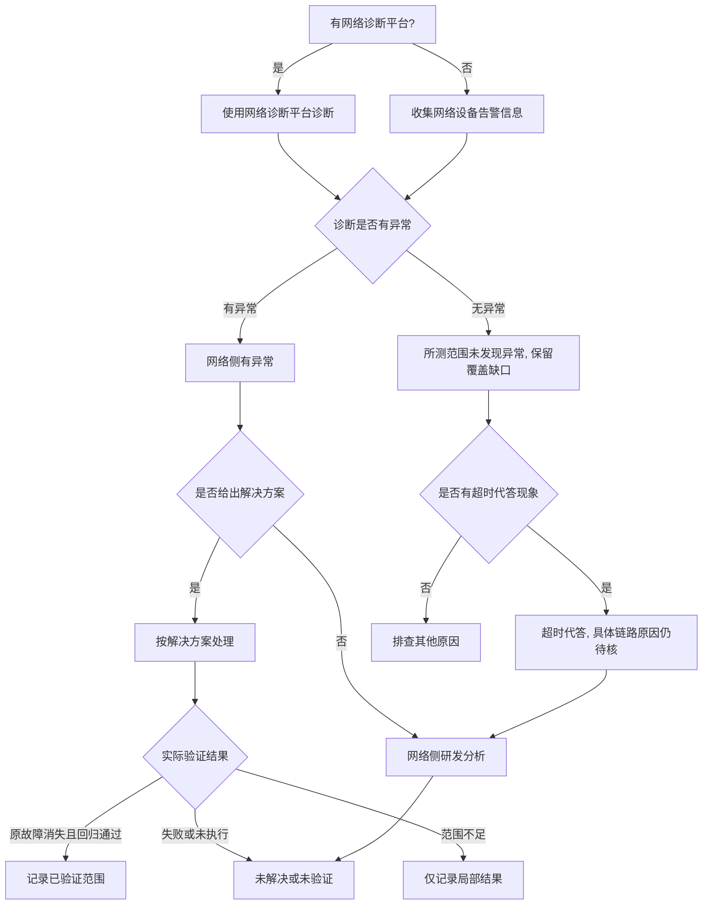

# 网络排查典型故障处理流

> **执行入口**：入口场景 `network`；也作为 `comm_timeout`/`hang` 中网络假设分支的细化流程。本流只离线分析已提供的网络诊断报告、网络设备告警、plog 中的 RoCE/HCCL 报错、连通性记录和验证记录，不执行现场连通性探测、抓包或网络配置变更。"使用网络诊断平台诊断""收集网络设备告警"转为核对已有诊断报告/告警记录。需要清洗或流水线产物时查 [公共约定](common-flow.md)。

## 问题现象

常见入口包括：

```text
[ERROR][HCCL] EI0002 Communication_Error_Timeout  # 通信超时（需进一步核对是否网络）
[ERROR] EI0013 ROCE CQE error
# 端口闪断 / Down
# 网络设备告警
# 丢包记录
```

`EI0002`/HCCL timeout 本身不证明网络故障，须有网络侧证据才能确认。
HIXL 的建链响应等待先核对[控制连接与底层通道阶段](../hixl-reference.md)，
不能把 Host 接收超时直接归为网卡/链路故障，也不能据此排除 Device 资源。
若已定位到 UB/URMA 资源创建或激活失败，继续下述[底层资源分支](#uburma-资源与地址转换)，
不要停在 HCCL/HCCP 的包装返回。

## 排查流程

网络排查流程主干：**核对已有诊断与端口/设备告警 → 关联故障端点、路径、负载及时间窗 → 解释已检测异常与未覆盖范围 → 比较网络和其他候选 → 条件修复与实际验证状态**。



| 顺序 | 证据 | 判断条件 | 下一步 | 中间过程记录 |
| --- | --- | --- | --- | --- |
| 1 | 网络诊断报告 | 是否对应本次端点、路径、协议、负载及故障时间窗 | 有→按所测范围解释；未覆盖部分保留未知，继续其他证据 | 记录平台、测试条件、覆盖与未覆盖范围 |
| 2 | 端口/链路状态记录 | 是否有端口闪断/Down 事件 | 有→网络方向候选；无→继续 | 记录端口名、闪断时间、是否与故障时间关联 |
| 3 | 网络设备告警 | 是否有告警记录 | 有→支持网络异常；无→不排除网络问题 | 记录告警时间、类型、设备、端口、严重级别 |
| 4 | 诊断报告结论 | 检测异常是否关联本次故障 | 有关联→支持具体网络候选；未发现异常→仅限所测范围，继续比较候选 | 记录结论、异常位置、关联和覆盖限制 |
| 5 | 网络侧研发分析结论 | 是否有研发分析 | 有→按结论处理；无→保留 hypothesis | 记录研发分析结论或"无研发分析" |
| 6 | 超时代答记录 | 是否与同一端点/路径/时间窗关联 | 有→追踪具体原因；无→保留覆盖限制并比较其他候选 | 记录代答类型（RPTX/RPRX/LPTX/LPRX）、端口、时间 |
| 7 | 解决方案验证记录 | 原故障、连通性和业务回归的实际结果 | 通过→限定已验证范围；失败→未解决；未执行/覆盖不足→未验证或局部结果 | 记录条件、结果和范围，不能由记录存在推通过 |

采用流水线产物模式时，每步过程写入 `diagnosis.md.result.steps`；默认诊断答复在正文说明关键核对过程及证据，不要求生成该文件。

## UB/URMA 资源与地址转换

仅在现场使用 UB/灵衢通信，且有底层资源、设备命令或地址转换线索时展开；
通信 UB 不是 AI Core Unified Buffer。只有 RoCE 告警或 Host 接收等待时，
按实际协议与阶段调查，不能据此假定存在 UMMU 故障。

- 从具体创建调用逐层追踪：JFC/CQ 的分配、属性配置、激活、资源地址映射是
  不同阶段。沿 HCCL/HCCP、URMA/UDMA、驱动与设备固件的原始错误继续向下查，
  保留每层调用名、返回值、对象和请求标识；包装返回不能代替底层原因。
- 若有 `UMMU`、`SATI`、`get pa`、`cmdq` 或 mailbox 失败，读取匹配原文的
  相邻上下文，并定向检查同次请求的内核、固件和 Host 日志。取 PA 失败伴随
  cmdq 读写/描述符检查失败，可具体定位到地址取得或命令处理路径异常；记录
  哪些已关联、哪些只在早期出现，不能只复述上层“资源异常”。汇总检索或工具
  输出截断时补读原文；扫描文件数和签名计数不代表所有上下文都已返回。
- 按 Host/设备、日志实体、die、队列和请求/序列号核对关联；采集目录设备号
  不必等于消息内部编号，不同层的 CQ/JFC/queue ID 不能直接互换。优先比较
  同一日志时钟的先后；跨时钟先核对偏移。TP AE、UB RAS 等事件须核对发生
  时间和实体，较晚或另一实体的异常不能直接作为本次创建失败的上游原因。
  事件缺少请求身份或明确的对象映射时，只称同次失败窗口中的相邻事件；
  时间接近和进程映射本身不能证明该事件属于某条命令或由该命令触发。
- 用现场版本的定义解释事件类型和位域。无故障地址、映射所有者/生命周期、
  命令对应关系时，保留原始值和已证异常路径，不能从 event/fault_type/ret
  数值猜出页表缺失、权限、特定寄存器、硬件损坏或双 die 实现缺陷。下一步
  检查具体缺失的地址映射、命令提交/完成和资源释放记录；按核实原因修复，
  以同条件资源创建、建链、传输校验及重复建断链验证，而非仅靠重启恢复。

阶段区分参考官方 hcomm
[`RsUbCtxJfcCreateExt`](https://gitcode.com/cann/hcomm/blob/a4069177f09618c64970cf2c9512bdbfedae304e/src/base_comm/resources/hccp/rdma_service/ctx/rs_ub_jfc.c)：
该版本依次初始化属性、设置选项、激活，再在适用模式取得并映射资源地址，
底层错误可被包装返回。此公开实现用于确定检查位置，不证明现场版本、
UMMU 事件定义或某项私有硬件机制。

## 证据盘点

| 材料 | 提取字段 | 缺失时的结论边界 |
| --- | --- | --- |
| 网络诊断报告 | 诊断时间窗、作业、异常结论、异常类型/位置 | 无报告则诊断分支 `unresolved` |
| 网络设备告警 | 告警时间、类型、设备、端口、严重级别 | 无告警不等于网络无问题 |
| plog 中 RoCE/HCCL 报错 | roce 报错原文、hccp 报错、时间、rank/device | 见 [超时流](hang-flow.md) 中通信分支 |
| 端口/链路状态记录 | 端口状态、闪断/Down 时间、链路错误计数 | 无记录则端口分支 `unresolved` |
| 连通性记录 | 已有连通性测试结果、端点、时间 | 无记录则连通性分支 `unresolved` |
| 网络侧研发分析 | 分析结论、异常定位、解决方案、验证记录 | 无分析保留 `hypothesis` |

## 判定矩阵

| 分支 | 支持所需证据 | 不能单独作为根因的信号 |
| --- | --- | --- |
| 网络设备/端口故障 | 端口闪断/Down + 告警 + 与故障时间关联 | 仅 HCCL timeout，无网络证据 |
| RoCE/链路异常 | roce 报错 + 链路错误 + 诊断报告异常 | 仅"有 roce 报错"，未关联到具体链路 |
| 超时代答 | 端点/路径和时间关联的代答记录及具体原因分析 | 仅"超时"或诊断未见异常，均不排除网络/业务候选 |
| HCCS 可用信用计数 | 对应接口、端点、时间及计数变化，关联业务进展和链路记录 | 单个信用计数不确认拥塞、故障或根因，也不是缓解动作 |
| RoCE PFC 反压 | 对应端口、方向、优先级队列及时间窗的 pause duration 等记录，关联业务进展 | PFC 持续时间不等于 HCCS 信用计数；单个值不确认具体拥塞原因或修复方案 |
| 非网络问题 | 排除网络后指向业务/OOM/掉卡等其他根因 | 不能因网络证据不足就跳到非网络结论，须有其他根因证据 |

## 子步骤产物

流水线模式每步更新同一个 `diagnosis.md.result.steps`，包含公共状态、输入/证据引用、缺口与 next_step。

| step_id | 执行动作 | findings 必含字段 |
| --- | --- | --- |
| N1 | 案例与网络事件入口核对 | signals、case_comparison、event_identity、has_diag_platform、classification_conflicts |
| N2 | 盘点诊断报告/告警/端口/连通性等材料 | material_inventory、versions、diag_report、network_alarms、port_events、roce_errors、connectivity_records |
| N3 | 按流程评估诊断有/无异常及网络侧分支 | first_error_candidate、diag_result（abnormal/normal）、network_side_result、branch_decisions、alternative_decisions、unresolved_links |
| N4 | 输出网络根因边界、建议和检查依据 | confirmed_facts、root_cause_status、limitations、recommendations、check_evidence |

N4 填满公共诊断字段。按已关联的设备/端口故障、配置错误或流控原因提出具体建议，标注适用前提与已有验证状态。信用计数和 PFC 记录先用于观测与追因，不能据此直接开出通用“反压缓解”处方；超时代答未解决时如实写明。

## 结论与评分边界

"已确认 <端口/链路/RoCE> 存在网络异常，证据 <诊断报告/告警原文>；<网络根因> 为 <confirmed/hypothesis/undetermined>。<缺口> 使 <具体判断> 仍无法确认。"

- D1 首错为网络报错/端口事件的最早记录；无明确行时 `has_first_error_line` 按实际定位判断。
- D2 诊断报告、网络告警、plog 属独立来源，可互证；同一来源副本不算多源。
- D3 网络根因需诊断报告/告警/链路证据闭合；仅 HCCL timeout 不够 `root_cause_localized`。
- D4 网络修复后验证记录才记 `fix_verified`；无验证不记。
- D5 命中历史网络案例须核对网络拓扑、设备、RoCE 配置异同。

参考：[公共约定](common-flow.md)、[故障处理专题](../fault-handling.md)、[超时流](hang-flow.md)、[错误码](../err-messages.md)、[可信度规范](../confidence-assessment.md)。
