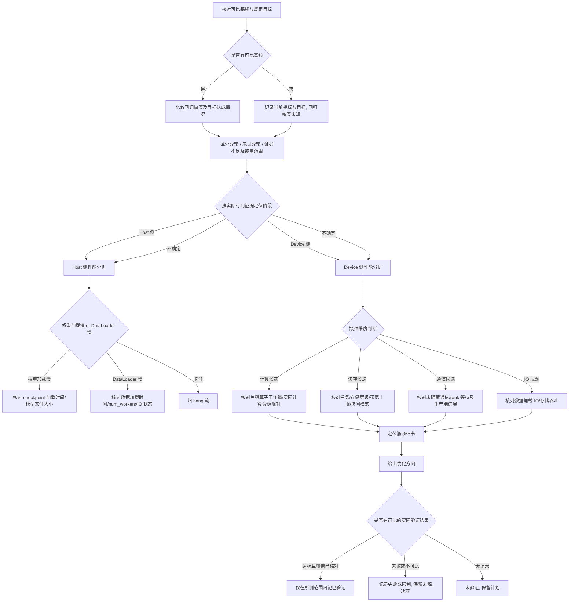

# 性能问题典型故障处理流

> **执行入口**：入口场景 `performance`。性能问题指训练或推理吞吐下降、延迟增大、迭代变慢或相比基线出现性能回归，进程仍在运行但效率低于预期。本流只离线分析已提供的 profiling 数据、plog、应用日志、性能基线和验证记录，不执行现场 `asys perf`、`npu-smi` 监控、profiling 重采或业务复跑。需要清洗或流水线产物时查 [公共约定](common-flow.md)。

> 性能问题与 hang 的区分：hang 是无进展或等待超时，performance 是有进展但效率低于预期；两者可共存，按主场景路由。

## 问题现象

常见入口包括：

```text
# 吞吐下降
throughput: 1500 samples/s (baseline: 3000 samples/s)
# 迭代变慢
step_time: 2.5s (baseline: 1.2s)
# Host 慢
weight loading time: 300s (baseline: 60s)
dataloader time: 1.8s/step (compute time: 0.3s/step)
```

性能问题不一定有 ERROR 级别日志，INFO/DEBUG 中的耗时统计、step 时间、吞吐指标和 profiling 数据是主要证据。

## 排查流程

性能问题定位流程主干：**核对可比基线或既定目标 → 确认异常及测量范围 → 定位关键路径上的耗时环节 → 解释计算 / 访存 / 通信 / IO 限制 → 给出优化方向**。

先核对负载、batch/shape、dtype、并发、预热/编译阶段、采集模式、时间窗口和单位。算子累计耗时、采样利用率与端到端延迟不是同一口径；并行流及通信/计算重叠区间不能直接相加。高耗时定位的是优先调查环节，资源受限机制还须由该任务的资源指标、工作量及关键路径支持。task-based与sample-based采集的归属和覆盖不同，不能把系统采样值自动归到报错kernel；解释方法见[度量分析](../../../metric-skill/references/metric-analysis.md#二性能分析框架)。



| 顺序 | 证据 | 判断条件 | 下一步 | 中间过程记录 |
| --- | --- | --- | --- | --- |
| 1 | 历史吞吐/step 时间/迭代耗时与既定目标 | 基线是否可比、目标是否明确 | 可比则量化回归；否则保留当前指标与目标差距，继续分阶段分析 | 记录负载、阶段、采集口径、单位、基线/目标及缺口 |
| 2 | 日志/profiling 中吞吐、延迟、step 时间 | 回归或目标违约是否有证据 | 说明异常、所测范围未见异常或暂无法判定；继续定位已观测耗时 | 记录当前指标、差值、覆盖范围与判断依据 |
| 3 | Host 耗时数据、堆栈快照 | Host 侧 or Device 侧 | Host→权重/DataLoader 分析；Device→瓶颈维度 | 记录 Host 耗时占比、Device 耗时占比、判断依据 |
| 4 | 权重加载时间、checkpoint 大小 | 权重加载是否慢 | 慢→Host 瓶颈候选 | 记录加载时间、文件大小、与基线对比 |
| 5 | 数据加载时间、num_workers、IO 吞吐 | DataLoader 是否慢 | 慢→Host 瓶颈候选 | 记录加载时间、worker 数、队列积压、IO 吞吐 |
| 6 | 算子耗时、工作量及匹配的计算资源指标 | 高耗时环节是否受计算资源限制且位于关键路径 | 只有时间占比时先定位慢算子；计算受限仍需机制证据 | 记录任务、dtype、工作量、资源模式、关键区间与比较依据 |
| 7 | 目标任务的内存带宽、传输量及访问模式 | 对应存储层级是否实际限制关键阶段 | 高带宽先作候选；核对可用上限、背景负载、冗余搬运和等待 | 记录采集模式、层级、任务归属、利用率、tiling与覆盖 |
| 8 | HCCL 时间、rank 进展、通信/计算时间线 | 未隐藏通信或等待是否限制目标关键路径 | 区分通信低效与慢rank/上游供给造成的等待 | 记录通信域、rank、操作、分母、重叠与未隐藏区间 |
| 9 | 优化验证记录 | 原问题是否在可比条件下达标且回归范围已核对 | 分别记未验证、失败、范围受限或已验证 | 记录变更、负载/环境/采集差异、实际结果与副作用 |

采用流水线产物模式时，每步过程写入 `diagnosis.md.result.steps`；默认诊断答复在正文说明关键核对过程及证据，不要求生成该文件。

### Host 侧性能分析

Host 侧问题分为"慢"和"卡住"两类，本流只处理"慢"：

| 子类型 | 核对内容 | 结论边界 |
| --- | --- | --- |
| 权重加载慢 | 已有日志中 `load_state_dict` / checkpoint 加载时间、模型文件大小与可比基线/目标 | 量化加载阶段及目标差距；无基线/目标时只报告实测耗时 |
| DataLoader 慢 | 数据加载时间、worker 数量、IO 吞吐、队列和计算重叠 | 仅在数据供给延迟阻塞关键路径时支持 Host 瓶颈；累计加载时间长不单独证明 |
| 权重加载卡住 | 已有进展/时间/依赖记录支持停滞，堆栈可定位加载或等待点 | 按停滞证据进入 [hang 流](hang-flow.md)，单次快照不足以判定 |
| 训练数据加载卡住 | 已有记录支持数据供给停止，结合worker/队列/IO及等待栈 | 按停滞证据进入 [hang 流](hang-flow.md)，区分慢加载与无进展 |

py-spy/gdb快照可帮助识别当时的执行或等待位置；单次栈不证明持续慢或无进展。没有堆栈时仍可用已关联的起止日志、吞吐、队列及IO记录定位对应范围，缺少时间覆盖或依赖证据的具体关系保持未决。

### Device 侧性能分析

| 维度 | 核对内容 | 结论边界 |
| --- | --- | --- |
| 计算瓶颈 | 关键算子耗时、工作量、实际dtype/模式与计算资源指标 | 高耗时不区分计算、访存和同步；结合对应资源限制及关键路径判断 |
| 访存瓶颈 | 目标任务对应层级的带宽、读写量、访问模式、tile/tiling及搬运 | 匹配任务在关键阶段的带宽/延迟限制才支持；核对背景负载、缓存及有效传输 |
| 通信瓶颈 | 同一通信域/操作的进展、rank等待、未隐藏通信与重叠 | 位于关键路径的通信/等待才限制目标；等待还须区分慢rank与网络/算法问题 |
| IO 瓶颈 | 数据加载 IO 时间、磁盘/网络存储吞吐、与 Device 计算的匹配度 | IO 等待大于计算时间支持 IO 瓶颈；须核对存储配置 |

## 证据盘点

| 材料 | 提取字段 | 缺失时的结论边界 |
| --- | --- | --- |
| profiling 数据（msprof/ait/asys perf，按实际输出核对） | 采集模式/级别、任务归属、算子耗时、通信时间、资源指标、timeline | 缺相应任务/资源/时间证据时限制具体机制；已有日志、硬件计数或受控记录仍可支持对应范围 |
| plog / 应用日志 | step 时间、迭代耗时、吞吐指标、权重加载时间、数据加载时间 | 缺相关计时限制阶段量化；已有Host profiler或其他匹配的起止记录仍可支持时间分析 |
| 性能基线 / 历史数据 | 基线吞吐、step 时间、迭代耗时、历史 profiling | 无基线则性能下降幅度不可量化，按绝对指标分析 |
| py-spy / gdb 堆栈快照 | 快照时间、线程、等待函数、调用链与时间覆盖 | 缺堆栈限制当时调用位置；已有耗时/依赖证据仍可定位相应阶段，单次栈不证明持续等待 |
| 模型与运行配置 | batch size、模型结构、优化器、num_workers、混合精度配置 | 配置影响性能预期；缺失则无法判断配置是否合理 |
| HCCL 通信配置 | world size、通信域、通信算法、buffer size | 缺失字段限制拓扑/算法或预期开销的判断；已有rank进展和任务时序仍可支持对应等待/通信定位 |
| 已有优化与验证记录 | 优化措施、变更前后性能对比、回归验证 | 无验证不记 `fix_verified` |
| npu-smi / 硬件状态快照及设备事件/计数 | 卡型号、频率、温度、健康状态及测量时段 | 缺相关状态/计数限制降频等具体判断；已有设备事件和受控记录可支持对应范围，单个温度值不证明性能根因 |

必须保留正常 step 的耗时记录、数据加载完成事件、通信进入/退出、权重加载完成等 INFO/DEBUG 行；它们是区分"慢"与"卡住"、量化性能下降幅度的主要依据。

## 判定矩阵

| 分支 | 支持所需证据 | 不能单独作为根因的信号 |
| --- | --- | --- |
| Host 侧计算/IO 瓶颈 | 已关联Host耗时/依赖位于关键路径，可比基线或既定目标支持异常；缺目标时只定位所测阶段 | 仅"用户说慢"或累计耗时占比高，无关键路径证据 |
| 权重加载慢 | 匹配负载/加载方式的耗时相对可比基线或既定目标异常；无基线/目标时只报告实测值 | 仅"大模型"、未核对加载时间或比较条件 |
| DataLoader 慢 | 数据供给/worker/IO时序及队列证据支持关键路径被阻塞 | 累计加载时间大于计算时间不排除预取/重叠，不能单独确定瓶颈 |
| Device 计算瓶颈 | 关键任务工作量、匹配dtype/模式的计算资源限制与耗时证据 | 高算子时间占比不单独证明计算受限 |
| Device 访存瓶颈 | 关键任务、存储层级、实际可用带宽/访问延迟、传输量及模式支持资源限制 | 高系统带宽、低计算利用率或存在memcpy均不足以单独确定 |
| 通信瓶颈 | 未隐藏通信/等待位于关键路径，且已核对同域rank与操作进展 | 通信累计耗时高、正常重叠通信或受害rank等待不单独证明通信根因 |
| 硬件降频/异常 | 匹配任务/时段的状态、设备事件或计数解释频率/限频原因，并关联正常对照与性能变化 | 仅有工具快照、单个温度值或未关联时间的告警，不证明性能根因 |
| 版本/配置变化引入 | 版本/配置变化前后性能对比 + 变化点定位 | 仅"换了版本"，未关联到性能变化 |
| 混合精度/编译策略影响 | 混合精度配置 + 编译策略 + 与基线对比 | 仅"用了 FP16"，未核对性能差异 |
| 非 NPU 性能问题 | 排除 NPU 侧后指向 CPU/IO/网络等其他瓶颈 | 不能因 NPU 侧证据不足就跳到非 NPU 结论，须有其他瓶颈证据 |

性能问题与 hang 的边界：进程无进展或等待超时归 hang；进程有进展但效率低于预期归 performance。两者同时出现时，hang 通常是更紧急的故障，按主场景路由，performance 作为次场景保留。

## 子步骤产物

流水线模式每步更新同一个 `diagnosis.md.result.steps`，包含公共状态、输入/证据引用、缺口与 next_step。

| step_id | 执行动作 | findings 必含字段 |
| --- | --- | --- |
| F1 | 案例与性能问题入口核对，确认基线与下降现象 | signals、case_comparison、event_identity、has_baseline、performance_drop_evidence、host_or_device（host/device/unknown）、classification_conflicts |
| F2 | 盘点 profiling/日志/配置/堆栈等材料 | material_inventory、versions、profiling_data、plog_metrics、baseline_data、stack_snapshots、model_config、hccl_config、hardware_status |
| F3 | 按 Host/Device 维度评估瓶颈环节，对齐竞争假设 | first_error_candidate、host_assessment、device_assessment、bottleneck_type（compute/memory/communication/io/unknown）、bottleneck_location、branch_decisions、alternative_decisions、unresolved_links |
| F4 | 输出性能根因边界、建议和检查依据 | confirmed_facts、root_cause_status、limitations、recommendations、check_evidence |

F4 填满公共诊断字段。性能问题的建议以优化算子、调整 batch/tiling、减少冗余搬运、优化通信策略、调整 DataLoader 配置、开启混合精度等为主，须标注适用前提与已有验证状态；无验证记录时不得写成已优化。

## 结论与评分边界

"已确认 <环节> 存在性能瓶颈，证据 <profiling/日志原文>；<计算/访存/通信/IO/Host> 瓶颈为 <confirmed/hypothesis/undetermined>。<缺口> 使 <具体判断> 仍无法确认。"

- D1 性能场景不一定有 ERROR，首错为首个性能异常/下降记录；无明确 ERROR 时 `has_first_error_line` 按实际定位判断，INFO/DEBUG 中的耗时异常可作为候选。
- D2 profiling、plog 和 npu-smi 属独立来源，可互证；同一 profiling 的不同视图不算多源。
- D3 性能根因需定位到具体瓶颈环节并有 profiling/日志证据；仅"整体慢"不够 `root_cause_localized`。
- D4 优化后性能提升验证才记 `fix_verified`；无验证不记。
- D5 命中历史性能案例须核对模型、版本、配置、硬件异同。
- 无 profiling 数据不裁剪本流、不额外封顶；现有日志可支持到何种范围就写到何种范围。仅有用户描述"慢"而无量化证据时，根因状态保持 `undetermined`，不凭描述下结论。

参考：[公共约定](common-flow.md)、[故障处理专题](../fault-handling.md)、[错误码](../err-messages.md)、[超时流](hang-flow.md)、[网络排查流](network-flow.md)、[可信度规范](../confidence-assessment.md)。
