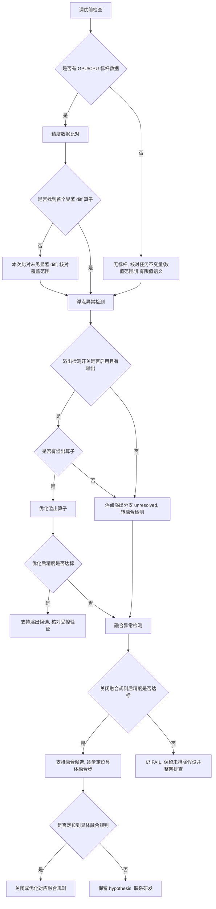

# 精度异常典型故障处理流

> **执行入口**：入口场景 `precision`。精度异常指计算结果与期望值偏差超阈值（loss 异常、NaN/Inf、精度不达标）。本流只离线分析已提供的 dump 数据、精度比对结果、溢出检测输出、融合规则配置和验证记录，不执行现场 dump 重采、复跑或开关切换。现场操作（"打开溢出检测开关""关闭融合规则""enable UB Fusion only"等）不执行，只在已有配置/输出中核对对应状态与结果。需要清洗或流水线产物时查 [公共约定](common-flow.md)。

## 问题现象

常见入口包括：

```text
loss = nan / loss = inf
max_diff=0.01 exceeds threshold=0.001
精度不达标 / accuracy not met
NaN detected in output tensor
```

## 排查流程

精度异常定位流程主干：**调优前检查 → 数据比对 → 浮点异常检测 → 融合异常检测 → 融合定位**。

先核对参考实现、输入/计算类型、容限及任务允许的非有限值语义。没有可比标杆时可检查已知数学/任务不变量和dtype范围，但不能凭输出绝对值大小验收一般正确性；合法掩码中的`-inf`不自动构成异常。已有检测和传播证据仍可定位具体机制，修复复测另行记录。

### 整数标量与浮点计算的源码追踪

当用户材料同时给出整数标量、浮点计算路径和可重复的舍入结果时，先用材料中的原值、
实际值和边界（例如 float32 的精确整数边界 `2^24`）复核转换行为，再追对应算子
的公开实现。查询不能停在 API 示例或算子注册；应继续读取实际 kernel 的架构变体，
特别检查 `T`（张量类型）、`ScalarT`（标量类型）和 `scalarCalcType` 的定义、条件选择、
构造转换以及乘法使用的类型。`arch35` 等路径与通用路径可能不同，必须按现场 SoC 选择，
并回读完整函数上下文。

若源码明确把 `ScalarT` 通过条件类型降为 `float`，且现场输入是超出 float32 精确范围的
int64，源码转换路径与用户材料中的量化结果可以共同确认“标量先被 float32 表示”的实现根因；
若只看到行为表或注册支持的 dtype，仍只能确认数值现象和转换候选。修复应绑定实际命中的
类型别名或转换点，保留 int64 精度语义，并用 `2^24` 附近、int32 边界、正负值和大数
回归验证；不能把改用 float64 当作自动完整修复。

### 最终任务指标下降

训练后accuracy、recall、收敛或业务评分下降，先区分训练张量差异、推理行为差异
和指标口径差异，再进入下述浮点/融合分支。只有个别数据集或子任务下降时，
同时检查该子集特有的输入和评分路径；不能从NPU/GPU评分差直接归责通信或算子。

用现有记录核对各阶段的对照条件；未提供的内容列为具体缺口，不执行新的现场采集：

| 阶段 | 比较对象与首个差异 |
| --- | --- |
| 训练产物 | 实际checkpoint/step、模型配置与权重、数据顺序、dtype、梯度归约及更新；同seed不保证同执行顺序 |
| 推理输入 | 同一原始样本ID/顺序、预处理、tokenizer版本/词表、输入模板/特殊token、截断/padding及最终token IDs；语义相近的字符串不保证输入相同 |
| 前向与生成 | 同一checkpoint及已对齐输入下的logits/首个张量差异，生成参数、随机采样与停止条件、生成token序列；teacher-forcing与自由生成不可混作同一比较 |
| 后处理与评分 | 解码、答案提取、归一化、标签/参考答案、阈值/分母/聚合；RAG另核语料、检索结果ID及recall实际定义，不把检索与生成评分混为一项 |

依已有材料确定差异首次出现在哪个边界。输入token已不一致时先解释配置或
预处理差异，不拿后续logits差定责设备计算；同输入前向开始分叉才继续查算子
和数值路径。生成一致而评分不同则回查后处理与评分实现。只提供总分时，
这些仍是待区分候选，不能宣称已找到某个模板、层或通信算法的错误。

相近loss或较高权重余弦相似度不保证任务指标等价，不单独排除训练数值分支；
通信算法、精度或确定性配置切换伴随评分变化，也不单独证明该项是首因。
保留各实验规模、版本与未完成评测的边界，修复及受控验证对应已支持的差异阶段。

若已给算子shape、切分、搬运参数或明确unroll/缓冲配置变化，先按
[算子切分与资源约束](../operator-boundary-reference.md)核对其具体机制，再结合
下述整网证据。无dump限制首个diff及传播确认，不阻止已有参数矛盾的推导。



| 顺序 | 证据 | 判断条件 | 下一步 | 中间过程记录 |
| --- | --- | --- | --- | --- |
| 1 | 标杆数据、任务数值契约、融合规则开关状态 | 标杆是否可比、非有限值是否允许、融合配置是否明确 | 有标杆则比对；无标杆仍核对不变量、范围及已有检测，误差达标保持未决 | 记录参考来源、输入/类型/容限、非有限值语义与缺口 |
| 2 | 精度 dump 比对结果 | 是否找到首个显著 diff 算子 | 是→浮点检测；否→核对比对覆盖与阈值，不直接排除精度问题 | 记录首个 diff 算子名、diff 值、阈值 |
| 3 | 溢出检测开关状态、溢出检测输出 | 是否有溢出算子 | 是→优化溢出算子；否→转融合检测 | 记录开关是否启用、溢出算子名、溢出值/位置 |
| 4 | 优化后精度验证 | 优化溢出算子后精度是否达标 | 是→结合检测输出与受控变更评估溢出候选；否→保留未排除假设并转融合检测 | 记录优化措施、变更前后精度对比 |
| 5 | 融合规则配置、关闭融合后精度 | 关闭融合规则后精度是否达标 | 是→支持融合候选，逐步定位；否→保留未排除假设并整网排查 | 记录关闭融合前后精度对比 |
| 6 | 逐步定位验证记录（仅 UB Fusion） | 是否定位到具体融合规则 | 是→关闭/优化对应规则；否→保留 hypothesis | 记录逐步比对的 Forward/Backward step、命中的融合规则 |

采用流水线产物模式时，每步过程写入 `diagnosis.md.result.steps`；默认诊断答复在正文说明关键核对过程及证据，不要求生成该文件。

### 融合定位伪码

融合定位核对顺序：

1. **核对浮点溢出**：检查检测开关、覆盖范围和实际溢出输出；优化后PASS若用于归因，须核对可比输入/环境下的受控变更及其他变化。已有输入、实际类型与传播证据可独立确认具体机制，优化/修复效果另记验证。
2. **核对融合开关**：优化后或关闭融合后仍 FAIL 不能单独排除溢出或融合，继续检查其他候选。关闭融合后 PASS 可支持融合候选，再定位具体融合步。
3. **逐步定位融合步**：仅打开 UB Fusion，逐步比对每个 Forward/Backward step 的数据，定位到具体融合规则。须有逐步验证记录支持，不能跳步指定。

## 证据盘点

| 材料 | 提取字段 | 缺失时的结论边界 |
| --- | --- | --- |
| 精度 dump 数据（GPU/CPU/NPU） | 算子/层、输入输出张量、shape/dtype、diff 值、阈值 | 无 dump 则无法做算子级精度比对 |
| 溢出检测输出 | 溢出算子、溢出值、位置、开关状态 | 无输出则浮点溢出分支 `unresolved` |
| 融合规则配置 | 图融合/UB 融合开关、具体规则列表、关闭/启用验证记录 | 无配置则融合分支 `unresolved` |
| loss/指标曲线 | loss 变化点、NaN/Inf 出现位置、与正常基线对比 | 仅 loss 异常不定位到具体算子 |
| 已有优化与验证记录 | 优化措施、变更前后精度、是否回归 | 无验证不记 `fix_verified` |
| 模型/算子与版本信息 | 模型结构、算子类型、CANN/框架版本 | 版本变化可能是精度变化点 |

## 判定矩阵

| 分支 | 支持所需证据 | 不能单独作为根因的信号 |
| --- | --- | --- |
| 浮点溢出 | 关联输入、实际计算/转换dtype、首个非预期非有限值或溢出输出，及违反任务契约的传播证据 | 仅loss=NaN、未关联检测事件或已被缩放器正确处理的事件，不证明业务异常首因；修复复测单独记录 |
| 融合规则导致 | 关闭融合后达标 + 逐步定位到具体规则的验证 | 仅"关闭融合后达标"未定位到具体规则 |
| 算子精度问题 | 算子级 dump diff + 算子类型 + 输入范围核对，或已给参数支持的具体边界/布局机制；仅后者不宣称已确认输出diff传播 | 仅"某算子 diff 大"，未核对输入与上游 |
| 数据/输入问题 | 输入违反既定数值/任务契约，且已关联其到异常输出的传播；修正效果另记验证 | 仅"精度不达标"或无契约的数值外观 |
| 版本/迁移引入 | 版本变化前后精度对比 + 变化点定位 | 仅"换了版本" |
| 整网其他原因 | 整网排查记录和具体候选证据 | 优化或关闭融合后仍 FAIL 不单独排除溢出、融合，也不证明其他根因 |

## 子步骤产物

流水线模式每步更新同一个 `diagnosis.md.result.steps`，包含公共状态、输入/证据引用、缺口与 next_step。

| step_id | 执行动作 | findings 必含字段 |
| --- | --- | --- |
| P1 | 案例与精度异常入口核对，调优前检查 | signals、case_comparison、event_identity、baseline_available、fusion_switch_status、classification_conflicts |
| P2 | 盘点 dump/溢出/融合配置等材料 | material_inventory、versions、dump_coverage、overflow_detection、fusion_config、loss_curve |
| P3 | 按伪码顺序核对浮点溢出→融合→算子，评估各分支 | first_error_candidate、overflow_assessment、fusion_assessment、op_diff_assessment、branch_decisions、alternative_decisions、unresolved_links |
| P4 | 输出精度根因边界、建议和检查依据 | confirmed_facts、root_cause_status、limitations、recommendations、check_evidence |

P4 填满公共诊断字段。精度问题的建议以算子优化、关闭/调整融合规则、改用高精度模式为主，须标注适用前提与已有验证状态。

## 结论与评分边界

"已确认 <算子/层/融合规则> 存在精度异常，证据 <dump diff/溢出输出原文>；<浮点溢出/融合/算子> 为 <confirmed/hypothesis/undetermined>。<缺口> 使 <具体判断> 仍无法确认。"

- D1 精度场景首错为首个显著 diff/NaN/Inf 的位置；无明确行时按 dump 比对结果定位。
- D2 dump 比对与溢出检测属独立来源；同一 dump 的不同切片不算多源。
- D3 精度机制按具体算子/融合规则的输入、计算与传播证据确认；缺修复复测不撤销已证实机制。仅"关闭融合后达标"不足以定位具体规则，修复有效性另记D4。
- D4 优化后达标验证才记 `fix_verified`；无验证不记。
- D5 命中历史精度案例须核对算子、版本、融合配置异同。

参考：[公共约定](common-flow.md)、[故障处理专题](../fault-handling.md)、[CASE-001/CASE-005](../cases.md)、[错误码](../err-messages.md)、[可信度规范](../confidence-assessment.md)。
